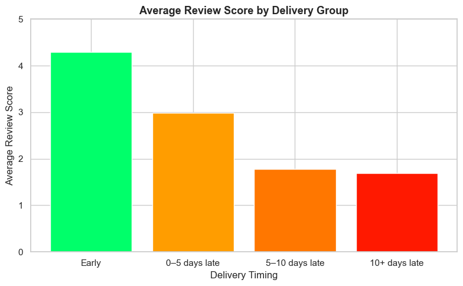
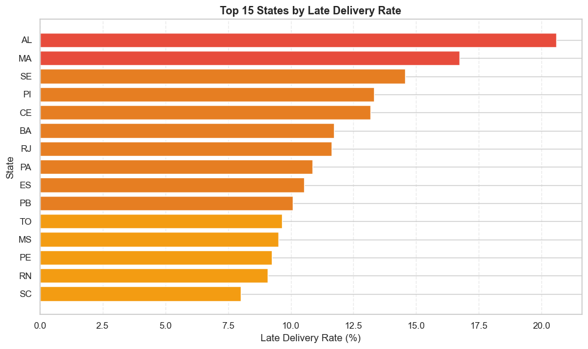

# Brazilian E-Commerce EDA: What Holds Back Inclusive Growth? (Olist, SDG 8)

Exploratory data analysis of about 100,000 orders from Olist, a Brazilian marketplace that connects small sellers to big platforms like Amazon and Mercado Livre (2016 to 2018). The analysis is framed around **SDG 8: Decent Work and Economic Growth** and asks what structurally limits e-commerce as an engine of inclusive growth.

## Key findings

| Question | Finding |
|---|---|
| Does delivery timing affect satisfaction? | Early deliveries average **4.29 stars**; orders 10+ days late drop to **1.69 stars**. Logistics is the strongest driver of satisfaction. |
| Are late deliveries regional? | Late deliveries cluster in the Northeast: **Alagoas (20.6%)** and **Maranhão (16.7%)** have the highest late rates. |
| Do customers come back? | Only **3%** of customers ever order again. Home appliances and fashion accessories retain best; books and computers worst. |
| Is e-commerce growing? | Monthly orders grew from about 300 (late 2016) to over 7,000 (Black Friday 2017). Mondays and afternoons are busiest. |
| How do Brazilians pay? | Credit card dominates (about 74%), often in instalments. Boleto bancário (about 19%) shows many buyers lack credit cards. |

**Conclusion:** the two structural barriers are regional logistics inequality and low customer retention.




All 9 charts are in [`figures/`](figures/). The full story is in the [slides](reports/presentation_slides.pdf) and [executive summary](reports/executive_summary.pdf).

## Repository structure

```
├── notebooks/eda_analysis.ipynb   # Full analysis: loading, merging, cleaning, EDA, charts
├── figures/                       # Exported charts
├── reports/                       # Presentation slides and executive summary (PDF)
├── data/
│   ├── raw/                       # Put the 9 Kaggle CSVs here (not included)
│   └── processed/                 # cleaned_dataset.csv is written here by the notebook
└── requirements.txt
```

## How to run

1. Install dependencies: `pip install -r requirements.txt`
2. Download the 9 CSV files from [Kaggle: Brazilian E-Commerce Public Dataset by Olist](https://www.kaggle.com/datasets/olistbr/brazilian-ecommerce) and put them in `data/raw/` (see [`data/README.md`](data/README.md)).
3. Open `notebooks/eda_analysis.ipynb` and run all cells. The notebook writes `data/processed/cleaned_dataset.csv` (95,824 rows).

## Team

Group 5, Data Mining and Visualization, BINUS University (2026)

- **Geoffrey Leslie**: data loading, merging and cleaning, EDA and visualisations, documentation
- **James Tiono**: data loading, EDA, visualisations, documentation
- **Kristoforus Vinan Adriska**: data loading, EDA, visualisations, documentation

## Limitations

- Data covers 2016 to 2018 only, before Brazil's pandemic e-commerce boom.
- Repeat purchases are limited by the dataset window.
- Geographic analysis is at state level, not city level.
- No seller-side data (revenue, churn), which limits direct claims about decent work.

## References

- Olist. *Brazilian E-Commerce Public Dataset.* Kaggle, 2018. https://www.kaggle.com/datasets/olistbr/brazilian-ecommerce
- United Nations. *Goal 8: Decent Work and Economic Growth.* https://globalgoals.org/goals/8-decent-work-and-economic-growth/
